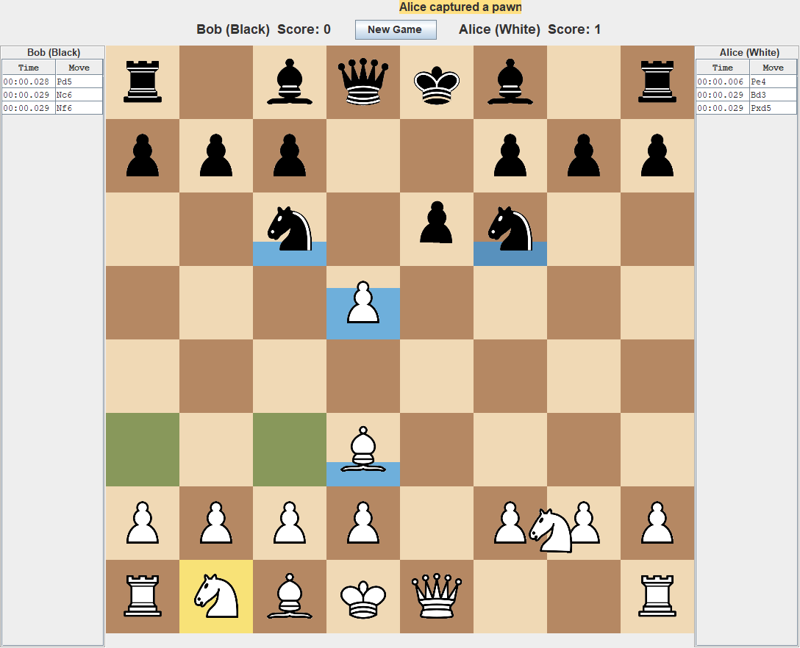
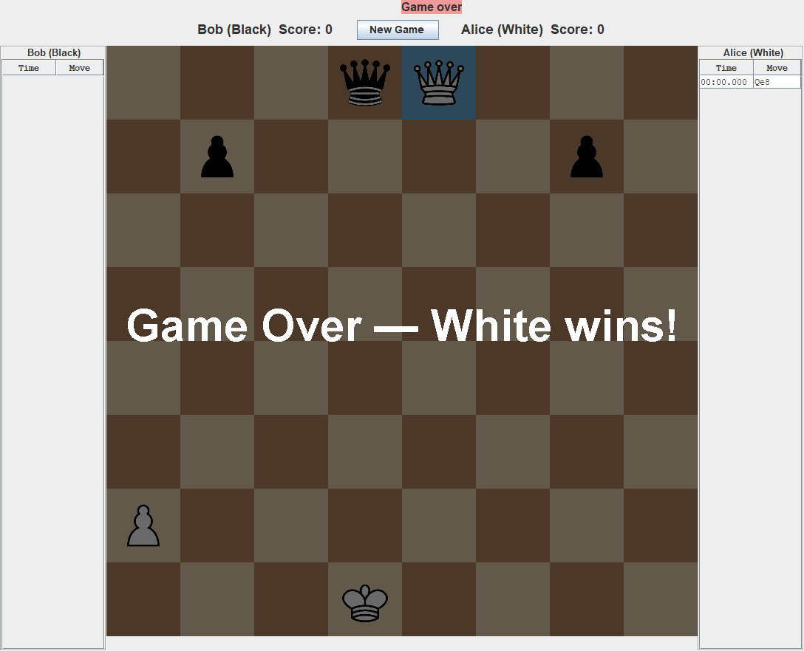
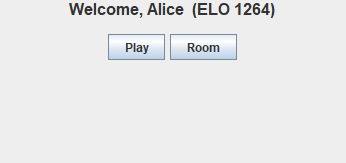
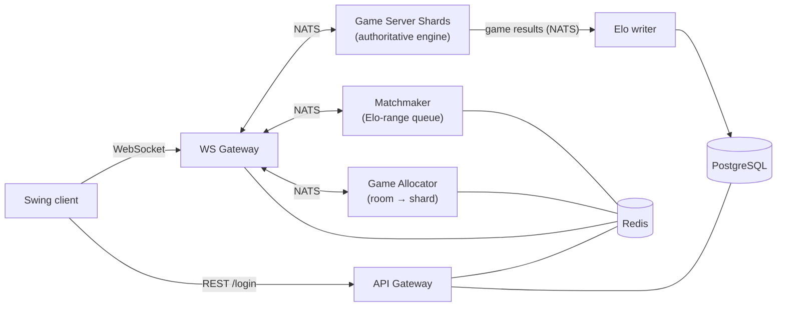

# KungFu Chess

[](https://github.com/Shifi-Aisenstain/KSChess-Play/actions/workflows/ci.yml)

**Real-time, networked chess.** There are no turns: both players move at the same time, a move takes time to travel and every piece has to rest afterwards, so what decides a game is timing, not who is "next".
Built in **Java 17** with a Swing client and a backend split into independent services (WebSocket gateway, game-server shards, matchmaking, room allocation, Elo persistence) that talk over **NATS**, with **Redis** and **PostgreSQL**, runnable with one `docker compose up` and ready for **Kubernetes**.



*A real game rendered by the project's own engine and renderer: the white knight is still travelling, pieces that have just landed show their cooldown bars (blue), the yellow square is the selected knight with its legal destinations in green, and the white pawn has just captured a pawn on d5.*

| Game over | Home screen |
|---|---|
|  |  |

## How the game works

- **No turns.** Any piece that is not busy can move at any time, for both colors at once.
- **Moves take time:** one second per square. The board changes only when the piece lands, and the path is checked again at that moment, so a move can fizzle if something got in the way.
- **Capturing:** a piece captures by landing on a square that holds an enemy piece. A pawn that reaches the last rank becomes a queen.
- **Cooldown:** after landing, the piece rests for 3 seconds and cannot move again.
- **Jump (right click):** a piece jumps in place for one second. An enemy piece that lands on that square during the jump is captured instead, so a jump is a dodge. A jumping piece is busy for two seconds in total.
- **The game ends when a king is captured.** Both players' Elo ratings are updated.
- Left click selects a piece and shows its legal destinations, a second click moves it.

## Features

- **Authoritative server.** The client only sends clicks; the engine in the game-server shard validates every move, keeps the clock (50 ms ticks) and publishes snapshots. The client never decides game rules.
- **Accounts and ratings:** login over REST with salted password hashes and session tokens in Redis, Elo rating (new players start at 1200), match history API.
- **Matchmaking:** an Elo-range queue (±100) in Redis, plus private rooms with a code that two players can create and join.
- **Resilience:** a disconnect starts a countdown and auto-resigns the player, reconnecting cancels it.
- **Scale-out design:** stateless gateways, rooms spread over shards by an allocator, Kubernetes manifests with autoscaling (HPA) on connections and active rooms, Prometheus alert rules, Jaeger tracing, health endpoints.
- **Load-test tool** that simulates many players and reports latency percentiles.
- **452 automated tests.**

## Architecture



| Process | Responsibility |
|---|---|
| **WS Gateway** | Holds every client WebSocket, validates the session token and relays messages. It decides nothing about the game. |
| **Game Server Shard** | Runs the rooms: the real-time engine, rules, cooldowns, disconnect timers. |
| **Matchmaker** | Pairs players whose Elo is within ±100. |
| **Game Allocator** | Creates and joins rooms and chooses the shard for each room. |
| **API Gateway** | REST: `POST /login`, game history, health and metrics. |
| **Elo writer** | Batches rating updates and game results into PostgreSQL. |

The design reasoning and the capacity plan are in [docs/Server_Design.md](docs/Server_Design.md) (Hebrew), the full technical reference is [docs/ARCHITECTURE.md](docs/ARCHITECTURE.md), and the split into services is described in [docs/PLAN_split_6_services.md](docs/PLAN_split_6_services.md).

## Tech stack

Java 17, Maven, Swing, [Java-WebSocket](https://github.com/TooTallNate/Java-WebSocket), Gson, Lombok, NATS, Redis, PostgreSQL (SQLite for local single-process runs), Docker and Docker Compose, Kubernetes (K3s) with HPA, Prometheus and Jaeger, JUnit 5 and JaCoCo.

## Run it

**Requirements:** JDK 17+, Maven 3.6+ and Docker.

**1. Backend** (6 services plus NATS, Redis, PostgreSQL and Jaeger):

```bash
docker compose up --build
```

The WebSocket gateway listens on `ws://localhost:8887` and the login API on `http://localhost:8080`. Jaeger is on http://localhost:16686.

**2. Client** (build once, then start one client per player):

```bash
mvn -q package -DskipTests
java -jar target/kungfu-chess-2.0.0-client.jar
```

The client asks for a username and password in the console (an unknown username is registered automatically with 1200 Elo). Use **Play** to queue for an opponent with a similar rating, or **Room** to create or join a private room with a friend. On Windows `run_client.ps1` does the build and the start for you, and `run_client.ps1 ws://<host>:8887 http://<host>:8080` connects to another server.

Configuration of every service is done with environment variables, listed in `docker-compose.yml` (for example `NATS_URL`, `REDIS_URL`, `POSTGRES_URL`, `SHARD_ID`, `PORT`).

**Kubernetes:** the manifests in [`k8s/`](k8s/README.md) deploy the same services with Redis, NATS, PostgreSQL, Prometheus, alert rules and autoscaling. See also [docs/HPA_AUTOSCALING.md](docs/HPA_AUTOSCALING.md), [docs/LOAD_TEST.md](docs/LOAD_TEST.md) and [docs/MULTI_REGION_AND_AGONES.md](docs/MULTI_REGION_AND_AGONES.md).

## Tests

```bash
mvn -q test
```

452 unit tests in `test/Test/unit` cover the rules, the real-time engine and cooldowns, the wire protocol, the event bus, authentication, Elo, matchmaking, rooms, the gateway, shard and allocator runtimes, metrics and the client bridge. Coverage report (JaCoCo): `target/site/jacoco/index.html`. The tests run on every push in GitHub Actions.

**End-to-end check.** The `docker compose up` stack was verified with the bundled load-test tool (`java -jar target/kungfu-chess-2.0.0-loadtest.jar --players=20`, see [docs/LOAD_TEST.md](docs/LOAD_TEST.md)) on a single laptop: 20 of 20 simulated players logged in, were matched, made a move and received the answer (move round trip p95 about 64 ms; matchmaking p95 about 5 s on that machine), and 18 of 20 games ended cleanly.

## Screenshots

The screenshots above are not mock-ups: [`ScreenshotGenerator`](test/Test/tools/ScreenshotGenerator.java) plays a scripted game in the real engine, draws it with the real renderer inside the real Swing windows and saves them as PNG files:

```bash
mvn -q test-compile
java -cp "target/classes;target/test-classes" Test.tools.ScreenshotGenerator docs/screenshots   # use ":" instead of ";" on Linux and macOS
```

## Project structure

```
src/
  models, rules, engine, realtime   domain model, move validation, the real-time engine and cooldown arbiter
  view, graphics, input, io         rendering, sprites, click-to-square mapping, board loading
  client/                           Swing client: connection, UI, sounds, controller
  shared/                           wire protocol (JSON), event bus, health, metrics, tracing, Redis and NATS helpers
  server/                           gateway, shard, matchmaking, allocator, API gateway, auth, Elo, persistence
  loadtest/                         load-test tool
test/Test/                          unit tests and the screenshot generator
assets/                             sprites, board image and the starting position (board.csv)
k8s/                                Kubernetes manifests
docs/                               architecture, design and operations documents
```
